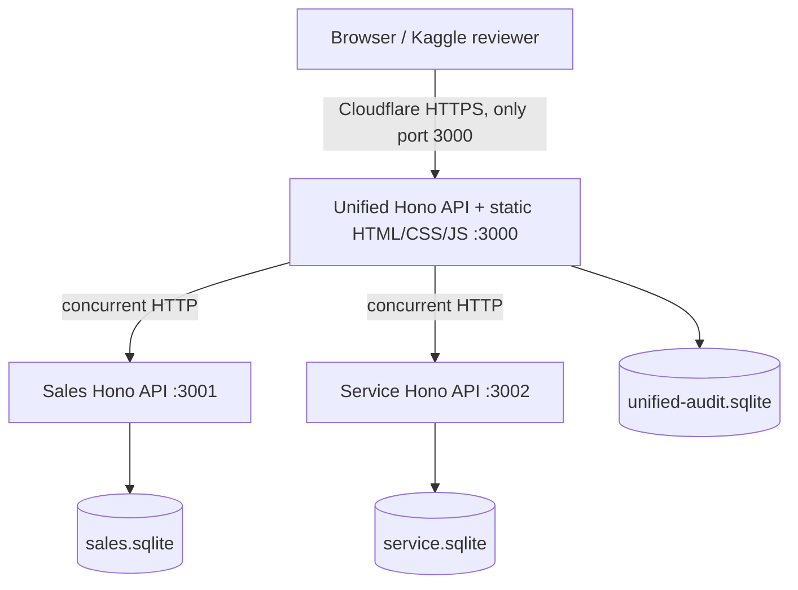
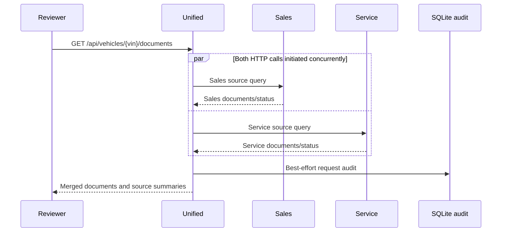

# System Design — Scenario D: Unified Document Viewer

**Implementation status (2026-10-09):** Foundation–Reviewer UI implemented, automated verification completed historically; Reviewer evidence notebook and evidence pipeline implemented, final Kaggle browser/import/submission acceptance outstanding. This describes the **actual implementation**, not only the original design intent.

## Objective and topology

One 17-character VIN lookup produces a consolidated, deterministic list of source-attributed Sales and Service document **metadata**. There are **two external source systems** and **three HTTP services**, because Unified is a separate orchestrator. Three SQLite files isolate Sales data, Service data and Unified request audits.

All application listeners bind loopback `127.0.0.1`. Only Unified :3000 is tunnel-eligible; source endpoints and test fault controls remain private. Each source has its own raw schema; Zod adapters normalize to common document and vehicle contracts. No distributed transaction spans the two sources.

## Request and concurrency sequence

1. Validate and uppercase VIN (17 characters, excluding I/O/Q); reject malformed input with HTTP 400.
2. Start Sales and Service outbound HTTP requests together using `Promise.all`. Both calls have independent timeout/error classification, including non-2xx HTTP, network refusal, invalid JSON and Zod schema violations.
3. Normalize source records, namespace document IDs with `SALES:` and `SERVICE:`, reconcile vehicle metadata, and deterministically sort by date descending and tie-break fields.
4. Persist nonblocking audit entry in `unified-audit.sqlite`, recording request ID, VIN, source outcomes/counts/timings, aggregate timing and partial status. Audit failures are surfaced, and readiness becomes degraded.
5. Return one response with documents, per-source status summaries, warning messages, partial flag and matching request ID.

## Response and failure matrix

| Condition | HTTP outcome | Behavior |
|---|---|---|
| Malformed VIN | 400 | Structured INVALID_VIN error |
| Both healthy, VIN exists | 200 | Merged, source-labeled list; may be empty |
| Both healthy, neither knows VIN | 404 | VEHICLE_NOT_FOUND |
| One technical failure | 200 | `partial=true`, healthy-source results and warning |
| Both technical failures | 503 | ALL_SOURCES_UNAVAILABLE |
| Conflicting source vehicle metadata | 200 | `vehicle=null` and explicit warning |
| Audit write failure | Otherwise determined outcome | Do not suppress result; flag persistence failure and degraded readiness |

Unknown VIN is distinct from an existing vehicle with zero documents. One source's NOT_FOUND is not the same as a technical failure.

## Data models and persistence

Sales and Service use deliberately **different mocked data models** and independent SQLite files, seeded with deterministic synthetic Faker fixtures. The Unified canonical record has `id,sourceDocumentId,source,type,title,date`. The API vehicle shape is `vin,make,model,year`; `sources.sales` and `sources.service` each include `status,durationMs,documentCount,vehicleFound` and optional `errorCode`. Correlated audit rows do not store PDF binaries or a replay of full user responses.

## Evidence and verification limitations

The private monotonic trace stores started/completed events for both HTTP intervals; reviewer evidence independently computes positive overlap, checks document counts and correlates the **same fresh requestId** across Sales, Service and Unified JSONL logs, trace JSON and SQLite audit. The notebook renders a timing PNG and retains run-scoped evidence. **Positive overlap demonstrates concurrently outstanding HTTP requests, not simultaneous CPU database instructions.** Earlier executions passed 26 Node and 7 Python evidence tests; current source edits require revalidation.

## Technology and architectural tradeoffs

- **Node.js 24 / TypeScript / Hono:** small explicit independent HTTP boundaries; **Zod:** validation of runtime data from mocked sources.
- **SQLite:** persistent and easy for Kaggle reproducibility, but not a shared highly available horizontally scalable datastore.
- **Vanilla HTML/CSS/JS UI:** deliberate Reviewer UI scope simplification instead of planned Vue/Tailwind; no CDN install required, single consolidated list with All/Sales/Service filters, source attribution, error and loading states.
- **Cloudflare Quick Tunnel:** optional temporary reviewer access; not production hosting, permanent DNS or authentication.
- No real dealership integrations, tenant isolation, production auth, binary PDF renderer, high availability or OpenTelemetry deployment is claimed.

## Human review and GenAI collaboration

AI was used for architecture comparison, failure policy and implementation/test scaffolding; code changes and test corrections were reviewed against compiler, integration and reproducibility evidence. Refer to `docs/AI-COLLABORATION.md` and individual execution reports. Historic success and yet-unverified reviewer-browser acceptance must not be conflated.
