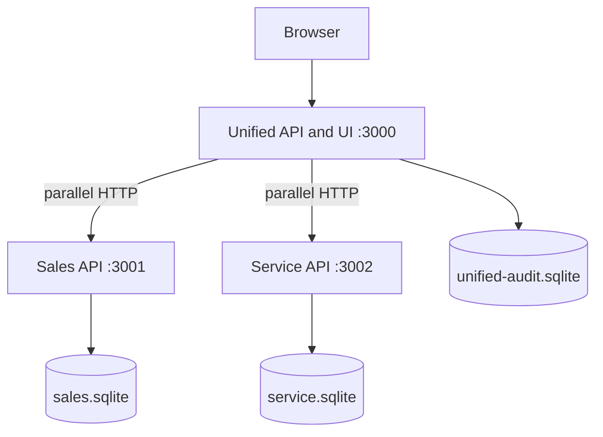

# System Design — Scenario D: Unified Document Viewer

**State:** Foundation design draft. Runtime aggregation and UI are not yet implemented.

## Purpose and acceptance
One VIN search, parallel real HTTP requests to independent mocked Sales and Service APIs, one combined source-attributed document list. The selected fully implemented layer is the backend; the UI is lightweight.

## Architecture

Each mocked system owns its own SQLite database and distinct raw JSON contract. Unified connects via HTTP only. All listeners bind loopback and only port 3000 is eligible for one optional Quick Tunnel.

## Technology justification
Node.js, TypeScript and Hono provide compact typed async HTTP services. Zod ensures runtime validation beyond TypeScript compilation. SQLite is persistent and easy to reproduce but not a shared horizontally scalable database. Vitest plus real-HTTP dynamic-port tests will prove upstream isolation and overlap.

## Contract and failure semantics
VINs contain 17 characters excluding I/O/Q. Canonical document IDs prefix `SALES:` or `SERVICE:`; records are sorted date-descending then source and ID. Both sources confirm unknown → 404; a known empty vehicle → 200 empty; one technically failing → 200 partial with warning; both technically failing → 503. HTTP 500 from an upstream is not fetch rejection and must be classified explicitly. Conflicting vehicle metadata becomes a null vehicle with warning.

## Data flow, observability and safety
Client → VIN validation → correlated concurrent upstream calls with per-source timeout → runtime schema validation/adapters → metadata reconciliation → combined sort → SQLite audit → response. Plans include monotonic overlap traces, sanitized JSONL, queryable request ID and nonblocking audit failures. There is no real customer data, production auth, document binary rendering or arbitrary public fault injection.

## GenAI design collaboration
AI assisted in reviewing the failure matrix and writing Foundation contract/tests/schema scaffold. Human review, measured evidence and any real corrections will be documented; no later-stage success is asserted. Production options (managed DB, tenant authorization, OpenTelemetry, circuit breakers) are future evolution, not deployed features.
