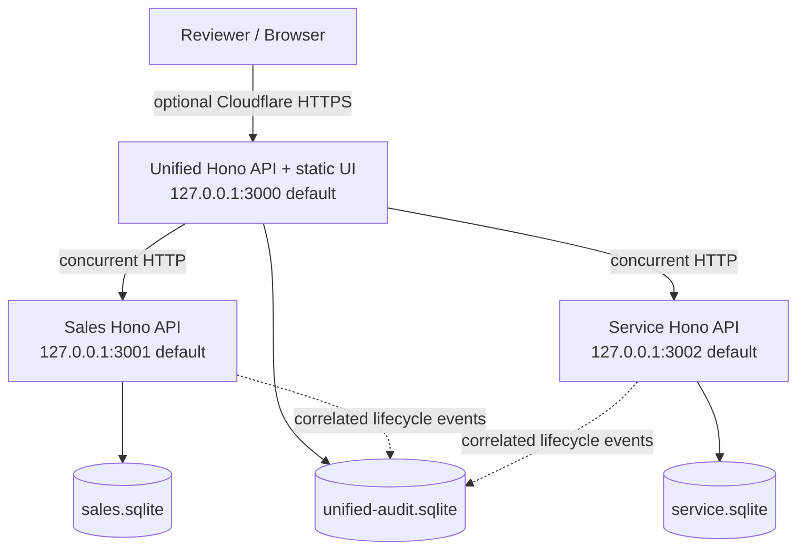

# Keyloop Scenario D — Unified Document Viewer
## System Design

**Status:** Implementation-aligned system design and engineering rationale
**Chosen challenge:** Scenario D — The Unified Document Viewer
**Implementation track:** Backend
**Demo client:** Lightweight vanilla HTML/CSS/JavaScript served by the Unified API
**Primary development/demo environment:** Kaggle Notebook (CPU)
**Server framework:** Hono.js for all three HTTP services

> **Canonical design artifact.** This is the repository's single public system-design authority. It combines the complete implementation-aligned specification with a reviewer-oriented summary. Executable code, OpenAPI contracts and automated tests remain the verification layer for implemented behavior.

### Reviewer summary

A single 17-character VIN lookup is handled by the Unified Hono service, which fans out concurrently over HTTP to two independently running mocked source systems: Sales and Service. Each source owns a separate SQLite business database and returns a deliberately different raw schema. Unified validates and normalizes both responses, merges source-attributed document metadata, applies explicit partial-failure semantics, and persists correlated request evidence in `unified-audit.sqlite`.

Only Unified is eligible for optional public access through a temporary Cloudflare Quick Tunnel. Sales and Service stay loopback-only. Durable reviewer evidence is exported by request ID through `GET /api/observability/requests/:requestId`; measured positive overlap demonstrates concurrently outstanding HTTP requests, not simultaneous CPU execution.

---

## 1. Purpose

Build a production-minded backend implementation for Keyloop Scenario D that demonstrates how one application aggregates vehicle-related document metadata from two independent mocked dealership systems.

The implementation provides:

1. A single VIN search interface and REST endpoint.
2. Two genuinely independent mocked external systems: Sales API and Service API.
3. A separate SQLite business database for each source system.
4. Parallel HTTP requests from Unified to both source systems.
5. Runtime validation and normalization of two deliberately different upstream response schemas.
6. One consolidated, source-attributed document list.
7. Deterministic Faker-generated synthetic automotive data.
8. Persisted request/audit evidence, correlation IDs, timings, health checks and failure-state visibility.
9. A reviewer-facing machine-readable evidence endpoint for a specific request ID.
10. A guided Kaggle notebook that installs, builds, tests, launches, exercises and explains the system.

The selected assessment implementation track is **Backend**. The browser page is a lightweight demonstration/test harness, not a claim that the frontend track was selected.

---

## 2. Requirement Mapping

| Scenario D / assessment requirement | Implemented response |
|---|---|
| Single search interface using VIN | `GET /api/vehicles/:vin/documents` plus a static VIN-search page |
| Backend calls two mocked external APIs | Unified calls separately running Sales and Service processes over HTTP |
| Requests must be parallel | Both source operations are started before awaiting and resolved together with `Promise.all(...)` |
| Consolidated list | Source adapters normalize and merge records into one canonical list |
| Clearly show source | Every canonical document has `source: SALES | SERVICE`; UI exposes source badges and filters |
| Backend track: REST API + persistence | Hono REST APIs; `sales.sqlite`, `service.sqlite`, and technical `unified-audit.sqlite` |
| Tests for core logic | Vitest unit/integration coverage plus Python reviewer-evidence tests |
| Future-minded design | Explicit service boundaries, validation, timeouts, partial failure, deterministic data, audit evidence, health/readiness |
| System Design Document | Single canonical specification at `docs/SYSTEM-DESIGN.md` |
| AI Collaboration Narrative | `docs/AI-COLLABORATION.md` and README narrative |

---

## 3. Scope

### 3.1 In scope

- Three independently running Node.js/Hono HTTP servers.
- Two independent dealership-domain SQLite databases.
- One separate technical/audit SQLite database.
- Deterministic fixtures from `@faker-js/faker`.
- Deliberately different Sales and Service raw schemas.
- Unified normalization, merge, deterministic sorting and provenance.
- Per-upstream timeouts and classified technical failures.
- Partial results when one source fails and the other remains usable.
- Persisted request-level audit data and append-only request lifecycle events.
- Human-readable reviewer request evidence page in reviewer mode.
- Machine-readable persisted-evidence endpoint.
- Vanilla HTML/CSS/JavaScript demo UI.
- Vitest and Python evidence-verifier tests.
- Guided Kaggle notebook and optional Cloudflare Quick Tunnel for Unified only.

### 3.2 Explicit non-goals

- Real dealership credentials, customer data or manufacturer APIs.
- Production authentication/authorization or tenant isolation.
- Upload/edit/delete document workflows.
- Binary PDF rendering as a core requirement.
- High availability, distributed transactions or multi-region deployment.
- Production OpenTelemetry infrastructure.
- Permanent public hosting or permanent tunnel DNS.

The challenge asks for a consolidated document view. Document **metadata** is sufficient for this implementation.

---

## 4. Architectural Principles

1. **Real HTTP boundaries, not in-process source stubs.** Sales and Service are separate processes.
2. **Independent business persistence.** Sales and Service never share a business database.
3. **Different upstream contracts.** Normalization is a real integration responsibility.
4. **Parallel fan-out by construction.** Both upstream operations are outstanding concurrently.
5. **Graceful degradation.** One technical source failure does not discard usable data from the other source.
6. **Fail-open audit behavior.** Failure to persist audit evidence does not replace an otherwise valid business response; readiness degrades instead.
7. **Evidence over claims.** Concurrency, correlation and aggregation are demonstrated by measurements/tests and persisted events.
8. **Minimal frontend complexity.** The browser client uses plain HTML/CSS/JavaScript with no frontend framework or build pipeline.
9. **One public entry point.** Sales and Service remain loopback-only; only Unified may be tunneled.
10. **Authoritative evidence is DB-backed.** Runtime logs/traces may support live diagnostics, but persisted SQLite events and the HTTP report are the durable reviewer evidence contract.

---

## 5. High-Level Architecture

Default local ports are shown; the Kaggle notebook can automatically choose another free three-port group when needed.



Only Unified is tunnel-eligible. The two source systems are internal integration boundaries and remain bound to `127.0.0.1`.

---

## 6. Component Responsibilities

### 6.1 Sales API

- Own `sales.sqlite`.
- Resolve vehicles by VIN.
- Return Sales-side document metadata using the Sales raw contract.
- Accept propagated `X-Request-ID`.
- Persist `sales_request_received` and `sales_response_sent` lifecycle events to `unified-audit.sqlite`.
- Support controlled test-only failure/delay modes.

### 6.2 Service API

- Own `service.sqlite`.
- Resolve vehicles by VIN.
- Return Service-side document metadata using a deliberately different raw contract.
- Accept propagated `X-Request-ID`.
- Persist `service_request_received` and `service_response_sent` lifecycle events to `unified-audit.sqlite`.
- Support controlled test-only failure/delay modes.

### 6.3 Unified API

- Serve the static browser UI and assets.
- Validate and normalize VIN input.
- Generate a `req_<uuid>` request ID.
- Call Sales and Service concurrently over localhost HTTP.
- Apply per-source timeouts and classify HTTP/network/schema/timeout failures.
- Normalize both raw contracts into the canonical document schema.
- Reconcile vehicle metadata, merge documents and sort deterministically.
- Return partial results when one source has a technical failure.
- Persist request-level audit data and lifecycle events.
- Expose health/readiness, demo VINs, business API, machine-readable evidence API and optional reviewer evidence page.

### 6.4 Browser demo client

Implemented as:

```text
public/index.html
public/assets/app.css
public/assets/app.js
```

It accepts VIN input, provides deterministic sample VIN shortcuts, shows loading/error/partial/empty states, renders one merged document list, filters All/Sales/Service, shows source attribution, and displays request/timing metadata.

**No Vue, Tailwind, Vite, Webpack, Rollup or CDN dependency is required by the final UI.**

---

## 7. Repository Structure

```text
apps/
  sales-api/src/
  service-api/src/
  unified-api/src/
packages/
  shared/src/
  logging/src/
database/
  sales.sql
  service.sql
  unified-audit.sql
public/
  index.html
  assets/app.css
  assets/app.js
scripts/
  fixture-data.ts
  migrate.ts
  seed.ts
  verify-seed.ts
  reviewer_evidence.py
  build-reviewer-notebook.py
tests/
  unit/
  integration/
notebooks/
  Keyloop-Scenario-D-Kaggle-Demo.ipynb
docs/
  SYSTEM-DESIGN.md
  AI-COLLABORATION.md
  decisions/
    ADR-001-backend-http.md
    ADR-002-local-static-ui.md
    ADR-003-persisted-request-events.md
openapi/
  unified-api.yaml
```

---

## 8. Deterministic Data Strategy

The implementation pins:

```text
FAKER_SEED=20261008
REFERENCE_DATE=2026-09-30
```

Canonical reviewer VINs are deterministic:

```text
VIN_BOTH          WVWZZZ1JZXW000001
VIN_SALES_ONLY    WVWZZZ1JZXW000002
VIN_SERVICE_ONLY  WVWZZZ1JZXW000003
VIN_NO_DOCUMENTS  WVWZZZ1JZXW000004
VIN_UNKNOWN       AAAAAAAAAAAAAAAAA
```

The generated dataset contains 25 vehicles in each source database. The two source databases are physically separate and are seeded from the same deterministic fixture definition without runtime database coupling.

---

## 9. Persistence Model

### 9.1 `sales.sqlite`

```text
vehicles(vin, make, model, year)
sales_documents(id, vin, category, title, contract_date, sales_person)
```

### 9.2 `service.sqlite`

```text
vehicles(vin, make, model, year)
service_events(id, vin, service_date, workshop, odometer)
service_documents(id, event_id, type, title, document_date)
```

### 9.3 `unified-audit.sqlite`

This is technical evidence storage, not a third dealership business system.

It contains:

- `request_audit` — one request-level summary row;
- `request_events` — append-only correlated lifecycle events.

`request_events` includes request ID, UTC timestamp, service, event, method/path, VIN, upstream, HTTP status, duration, document count, partial flag, error code and optional metadata JSON. Events are read in `(request_id, occurred_at, id)` order.

---

## 10. Upstream API Contracts

Both source services intentionally use the same route shape while returning distinct payload schemas:

```http
GET /api/vehicles/:vin/documents
```

### 10.1 Sales raw envelope

```json
{
  "vehicleFound": true,
  "vehicle": {"vin":"...","make":"Volkswagen","model":"Golf","year":2018},
  "salesDocuments": [
    {
      "salesDocumentId":"SAL-1001",
      "documentCategory":"Purchase Agreement",
      "documentTitle":"Vehicle Purchase Agreement",
      "contractDate":"2026-08-26",
      "salesPerson":"Synthetic Name"
    }
  ]
}
```

### 10.2 Service raw envelope

```json
{
  "exists": true,
  "vehicleDetails": {"vinCode":"...","brand":"Volkswagen","name":"Golf","modelYear":2018},
  "records": [
    {
      "id":"SRV-9001",
      "type":"Service Invoice",
      "label":"Scheduled Maintenance Invoice",
      "serviceDate":"2026-09-28",
      "workshop":"Synthetic Workshop 1"
    }
  ]
}
```

Zod validates both raw contracts before adapters may contribute data to the Unified response.

---

## 11. Canonical Unified API

### 11.1 Main route

```http
GET /api/vehicles/:vin/documents
```

### 11.2 Canonical document

```json
{
  "id":"SALES:SAL-1001",
  "sourceDocumentId":"SAL-1001",
  "source":"SALES",
  "type":"Purchase Agreement",
  "title":"Vehicle Purchase Agreement",
  "date":"2026-08-26"
}
```

IDs are namespaced as `SALES:<source-id>` or `SERVICE:<source-id>`.

### 11.3 Source status model

```text
SUCCESS | EMPTY | NOT_FOUND | TIMEOUT | HTTP_ERROR | NETWORK_ERROR | INVALID_RESPONSE
```

A successful response includes `requestId`, `vin`, `partial`, reconciled `vehicle`, per-source summaries, `documents`, `documentCount`, `warnings`, `auditPersisted`, and `totalDurationMs`.

Documents are sorted newest-first by `date`, then deterministically by source and source document ID.

---

## 12. Failure and Status Semantics

| Condition | HTTP outcome | Behavior |
|---|---:|---|
| Invalid VIN | 400 | `INVALID_VIN` |
| Both sources healthy; vehicle known | 200 | Complete merged result, possibly zero documents |
| Both sources definitely report unknown VIN | 404 | `VEHICLE_NOT_FOUND` |
| One technical source failure; other source usable | 200 | `partial=true`, usable results preserved |
| Both sources fail technically | 503 | `ALL_SOURCES_UNAVAILABLE` |
| Conflicting vehicle metadata | 200 | `vehicle=null` plus warning; documents remain usable |
| Upstream malformed JSON/schema | source classified `INVALID_RESPONSE` | Partial or 503 follows normal source-health rules |
| Audit persistence failure | business status unchanged | `auditPersisted=false`; readiness degrades |

A known vehicle with zero documents is intentionally different from an unknown VIN.

---

## 13. Parallelism and Timing Evidence

The Unified API records monotonic timing with `performance.now()` around each source request.

Both source operations are started together and resolved via:

```ts
const [sales, service] = await Promise.all([
  requestSource(/* Sales */),
  requestSource(/* Service */),
]);
```

`requestSource()` converts timeout, HTTP, network and invalid-payload conditions into typed source outcomes, so outer `Promise.all()` can resolve both classified outcomes without losing graceful-degradation behavior.

The request trace records start/end intervals. Positive interval overlap proves the two HTTP requests were outstanding concurrently. This is evidence of concurrent I/O, not a claim that two SQLite instructions execute simultaneously on CPU.

---

## 14. Observability and Reviewer Evidence

### 14.1 Persisted lifecycle

A successful complete request contains 11 correlated lifecycle event types:

1. `browser_request_received`
2. `sales_request_started`
3. `service_request_started`
4. `sales_request_received`
5. `service_request_received`
6. `sales_response_sent`
7. `service_response_sent`
8. `sales_response_received`
9. `service_response_received`
10. `aggregation_completed`
11. `browser_response_sent`

All events use the same propagated request ID. The Sales-side and Service-side receive/response events may interleave because those HTTP operations are concurrent; the contract requires the complete correlated lifecycle, not an invented total ordering between the two independent sources.

### 14.2 Machine-readable reviewer endpoint

```http
GET /api/observability/requests/:requestId
```

It reads persisted events from `unified-audit.sqlite` and returns chronological events, request timing, source status/document counts, aggregation information and deterministic checks including correlation consistency and observed parallel fan-out.

Unknown request IDs return HTTP 404 with `REQUEST_NOT_FOUND`.

### 14.3 Human-readable reviewer evidence

When reviewer mode is enabled with `REVIEWER_PUBLIC_EVIDENCE=1` outside production, the running process exposes:

```http
GET /reviewer/requests/:requestId
```

The bounded in-memory capture renders the same request's source responses, Unified response, counts, timings, measured overlap and timing timeline.

### 14.4 Runtime logs and traces

The implementation emits concise JSON runtime logs and can write bounded private trace summaries when explicitly enabled. The notebook's Step 18 live monitor tails private runtime logs and cross-checks SQLite to surface newly generated browser requests.

These runtime files are **supplementary diagnostics/live monitoring**. The authoritative durable evidence contract is `unified-audit.sqlite` plus `GET /api/observability/requests/:requestId`.

---

## 15. Health and Readiness

Each service exposes liveness/readiness endpoints under `/api/health/...`.

Unified readiness also reflects audit persistence health. If audit persistence degrades, the business endpoint remains fail-open where possible, while readiness reports a degraded/503 state.

---

## 16. Browser UI Design

The browser UI uses vanilla HTML, CSS and JavaScript served directly by the Unified API. It has no frontend framework, CDN dependency or build pipeline.

Reviewer-facing states include initial/search, loading, success, known vehicle with zero documents, unknown VIN, invalid VIN, partial result and total source failure.

The UI also exposes sample VIN shortcuts, source filters, document counts, request ID, source durations and total duration.

---

## 17. Testing Strategy and Current Baseline

The repository uses **Vitest**, TypeScript compiler checks, ESLint and Python evidence tests.

Current locally verified baseline:

```text
npm run typecheck   PASS
npm run lint        PASS
npm run build       PASS
npm test            PASS
Node tests          27 passed
Python evidence     15 passed
git diff --check    PASS
```

The integration suite uses real local HTTP servers and validates source contracts, failure classes, partial responses, 503 behavior, audit persistence, reviewer evidence and concurrency.

---

## 18. Kaggle Reviewer Notebook

Canonical notebook:

```text
notebooks/Keyloop-Scenario-D-Kaggle-Demo.ipynb
```

It contains 18 guided steps:

1. Kaggle setup.
2. Fetch public source.
3. Install Node dependencies.
4. Validate source code.
5. Build three isolated SQLite databases.
6. Run automated tests.
7. Launch Sales API.
8. Launch Service API.
9. Launch Unified API and frontend.
10. Confirm readiness.
11. Run a real VIN search.
12. Prove parallel HTTP execution.
13. Check degraded behavior.
14. Verify audit persistence.
15. Inspect the timing chart.
16. Open the interactive frontend / optional tunnel.
17. Review final evidence.
18. Optionally monitor new live browser requests at 10-second intervals.

Default ports are `3000/3001/3002`; the notebook scans for a free alternative group if necessary. Only Unified is exposed by the optional tunnel.

Step 18 is a bounded live monitor and is intentionally separate from the completed Steps 01–17 acceptance flow.

---

## 19. Security and Data Safety

- All people/customer-like fields are synthetic.
- No credentials are committed.
- Public demo exposes only Unified.
- VIN input is validated before integration calls.
- SQLite statements use parameters.
- Browser errors do not expose stack traces.
- Reviewer evidence is bounded and disabled in production mode.
- Source fault injection is test-only and not part of the public normal flow.

---

## 20. Reliability and Future Scalability

Current challenge implementation intentionally favors reproducibility and inspectability: local SQLite, local HTTP services, one Node process per service, explicit timeouts, deterministic fixtures and a lightweight static UI.

A production evolution could replace SQLite with a managed database, mocked APIs with authenticated dealership integrations, process-local deployment with orchestration/autoscaling, and local diagnostics with centralized observability/OpenTelemetry. The source-adapter boundary isolates external schema differences from the canonical API.

---

## 21. Technology Choices

- **Node.js 24 + TypeScript:** async HTTP integration, native `fetch`, strong tooling and reviewer-readable code.
- **Hono.js:** used consistently across all three servers with small explicit HTTP boundaries.
- **Zod:** validates raw upstream payloads and canonical response contracts at runtime.
- **SQLite / `better-sqlite3`:** persistent, inspectable, deterministic storage with no external infrastructure.
- **`@faker-js/faker`:** deterministic synthetic data without real PII.
- **Vitest:** current unit/integration test runner.
- **Vanilla HTML/CSS/JavaScript:** provides the Scenario D search and review UI without a frontend framework, CDN dependency or build pipeline.
- **Cloudflare Quick Tunnel:** optional reviewer transport for Unified only; not production hosting.

---

## 22. AI Collaboration and Verification Strategy

GenAI assists with architecture comparison, implementation scaffolding, test design, failure analysis, documentation and reviewer-evidence presentation. Final acceptance does not rely on AI assertions.

Important claims are checked through compiler/linter/test output, real HTTP integration tests, deterministic fixture verification, SQLite evidence, timing overlap, source inspection and human review.

The dedicated public narrative is maintained in [`AI-COLLABORATION.md`](AI-COLLABORATION.md) and summarized in the repository README.

---

## 23. Current Design Invariants

The following implementation choices are part of the current system contract and are described consistently across this document, OpenAPI, tests and reviewer evidence:

- Unified, Sales and Service are three separate Hono HTTP processes.
- Default ports are `3000`, `3001` and `3002`; the Kaggle notebook may select a free alternative group.
- Sales and Service own independent business databases: `sales.sqlite` and `service.sqlite`.
- `unified-audit.sqlite` is a technical audit/evidence database, not a third dealership source.
- Both source calls use `/api/vehicles/:vin/documents` but return deliberately different JSON schemas.
- Unified starts both source operations together and resolves them with `Promise.all(...)`; each `requestSource()` call converts network, timeout, HTTP and schema failures into a typed source outcome.
- One technical source failure returns HTTP 200 with `partial=true` when the other source is usable; two technical failures return HTTP 503 with `ALL_SOURCES_UNAVAILABLE`.
- Canonical documents use `id`, `sourceDocumentId`, `source`, `type`, `title` and `date`.
- Durable reviewer evidence is persisted in `unified-audit.sqlite` and exported through `GET /api/observability/requests/:requestId`.
- Runtime logs, optional trace files and the live monitor are supplementary diagnostics, not the authoritative evidence contract.
- The browser client is vanilla HTML/CSS/JavaScript.
- The guided reviewer notebook is `notebooks/Keyloop-Scenario-D-Kaggle-Demo.ipynb` with Steps 01–18.

---

## 24. Verification Baseline

At the documented baseline, the repository passes 27 Node/Vitest tests and 15 Python evidence tests. The test suite covers deterministic fixtures, raw-source contracts, normalization, real local HTTP integration, failure classification, partial/503 semantics, request lifecycle persistence, evidence export and concurrency measurements.

Execution evidence is generated from real requests and measured timings. The documentation does not treat historical logs, handwritten PASS markers or inferred behavior as substitutes for executable verification.

---

## 25. Document Authority and Maintenance

This file is the repository's single canonical System Design document. Architectural decisions that benefit from focused rationale are recorded separately under [`decisions/`](decisions/), while [`AI-COLLABORATION.md`](AI-COLLABORATION.md) documents how GenAI assistance was used and independently verified.

When implementation behavior changes, update this System Design together with affected OpenAPI contracts, tests and ADRs. Historical development reports and intermediate execution snapshots are intentionally excluded from the public documentation set; Git history preserves development chronology without presenting superseded states as current behavior.
